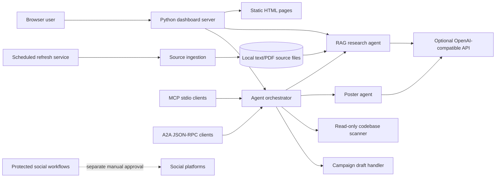

# Biomarker Research and Campaign Platform

Product and technical guide for the Biomarker repository. This describes the implementation in this branch, not a deployment certification or medical product.

## 1. Product Summary

Biomarker is a source-grounded childhood-cancer information workspace with a static browser dashboard, a Python HTTP server, a local RAG research assistant, a reviewed poster generator, workspace code search, and campaign-draft/publishing assets. It is intended for educational research and preparation of human-reviewed material.

It is not a clinical decision-support system. It does not diagnose, prescribe, estimate an individual child's prognosis, select a treatment, provide emergency triage, or autonomously publish social content.

### Primary users

- Families and community members using the dashboard and cited public information.
- Researchers and project maintainers refreshing and reviewing local source material.
- Editors preparing source-linked poster or campaign drafts.
- Developers and AI clients consuming the agent tools through MCP or A2A.

### User-facing capabilities

- Research dashboard and source-grounded Q&A.
- Treatment-plan conversation guide, care-location directory, and mortality-estimate page.
- Poster generator with an offline reviewed childhood-cancer preset and optional configured language-model generation.
- Research radio/fundraising episode pages and media.
- Multi-agent task routing for research Q&A, poster draft, read-only project search, and campaign draft.
- MCP tools/resources and A2A 1.0 agent discovery/task protocol adapters.

## 2. System Context



The diagram separates content drafting from publisher integrations. The orchestrator does not call the social publisher workflows.

## 3. Repository Code Map

| Path | Responsibility |
| --- | --- |
| `server.py` | Threaded Python HTTP server, JSON APIs, static-file allowlist, poster/RAG/agent endpoints. |
| `agent.py` | Local document loading, chunking, lexical retrieval, and source-cited LLM answer generation. |
| `ingest.py` | Downloads/refreshes configured public source materials into the local `data/` directory. |
| `research_refresh.py` | Periodic refresh, file hashes/metadata, changed-source tracking, index rebuild and status. |
| `multi_agent/orchestrator.py` | Explicit task registry, skill contracts, task validation, traces, and sequential research-to-campaign workflow. |
| `multi_agent/mcp_server.py` | MCP stdio tools and resources delegating to the shared orchestrator. |
| `multi_agent/a2a_server.py` | A2A 1.0 Agent Card and JSON-RPC task server using the A2A SDK. |
| `multi_agent/evals.py` | Offline evaluations for citations, draft status, publication prohibition, evidence paths, and secret leakage. |
| `multi_agent/eval_cases.json` | Versioned deterministic test/evaluation cases. |
| `codebase_agent/scanner.py` | Workspace discovery and read-only topic search; skips sensitive, generated, and dependency locations. |
| `poster_agent/` | Poster prompt, model response validation, reviewed preset, theme definitions, safe HTML renderer, and UI. |
| `social_campaign_agent/` | Campaign publishing workflows, publisher scripts, operational documentation, and mock tests. |
| `dashboard.html` | Dashboard landing page and browser links to feature pages. |
| `care-locations.html`, `treatment-plan.html`, `death-estimates.html` | Educational reference pages. |
| `fundraising.html`, `fundraising-episode.html`, `radio-channel.html`, `media/` | Campaign planner, episode content, radio page, and audio/video assets. |
| `childhood-cancer-site/` | Separate static field guide, reports, local research assets, and short-video materials. |
| `.github/agents/` | Repository agent role definitions, including the new multi-agent orchestrator role. |
| `.github/skills/` | Reusable task contracts for research, poster drafting, codebase search, and campaign drafting. |
| `.github/prompts/` | Human-invoked prompt workflows for research and campaign tasks. |
| `tests/`, `test_*.py`, `test_scripts/` | Unit/API/browser checks, including the new multi-agent eval tests. |

## 4. Data and Research Flow

1. The ingester retrieves configured public NCI/ACS materials and stores local text/PDF artifacts under `data/`.
2. `ChildhoodCancerAgent` parses text and (when available) the biomarker PDF, splits documents into overlapping passages, and indexes source identifiers in memory.
3. A question is matched with lexical token scoring. If no passage is sufficiently relevant, the assistant returns a no-match response rather than inventing an answer.
4. When relevant passages exist, the configured OpenAI-compatible endpoint receives only the question and selected passages. The system instruction requires answers to remain within excerpts and cite `[S#]` IDs.
5. The browser assistant resolves returned source URLs into links. Personal treatment questions must be taken to a qualified pediatric oncology team.
6. `ResearchRefreshService` periodically refreshes data, records source filename, SHA-256, bytes, and modification time, identifies changed artifacts, and rebuilds the in-memory index after successful source retrieval.

The current index and source catalog are local files and in-memory structures. There is no vector database, central data catalog service, institutional reconciliation approval workflow, or distributed job queue in this implementation.

## 5. Multi-Agent System

The orchestrator uses explicit task types rather than unconstrained dynamic tool selection:

| Task type | Agent | Inputs | Output / guardrail |
| --- | --- | --- | --- |
| `research_question` | Research Assistant | `question` | Answer and cited source list; no diagnosis or prescription. |
| `poster_draft` | Poster Drafter | optional reviewed preset | Reviewed poster HTML and alt text; `DRAFT / NEEDS REVIEW`; publication disabled. |
| `codebase_search` | Codebase Researcher | `topic`, optional `terms` | Bounded paths and matching excerpts within configured root; no full file content and no mutation. |
| `campaign_draft` | Social Campaign Drafter | `topic`, `audience`, `platform`, optional evidence and sources | Draft copy, citations, disclaimer, explicit `publication.allowed=false`. |

`research_to_campaign_draft` is a sequential workflow: retrieve and answer from source excerpts, then pass the answer and source list to the campaign draft handler. Each run returns an ID and start/completion trace.

The system currently runs these agents in-process and sequentially. It does not implement a distributed worker pool, parallel task graph scheduler, durable task queue, automatic retries, human approval UI, or multi-tenant identity/access control.

## 6. Skills and Safety Contracts

Task contracts are stored in `.github/skills/` and mirrored in `AgentSkill` definitions. The poster drafting skill follows `.github/prompts/create-childhood-cancer-awareness-poster.prompt.md`: source citations, population framing, accessible alt text, disclaimer, and draft-only status. These constraints prevent the app from treating a successful generated asset as approval to publish.

Campaign publication is separate from orchestration. The repository's publisher scripts/workflows require their own inputs, preview mode, protected environments, credentials, and (where configured) human review. The orchestrator deliberately contains no publisher task type and no social platform credentials.

## 7. Agent Protocols and Local Use

### Dashboard API

Start the Python dashboard server from the repository root:

```sh
python server.py --port 8765 --skip-initial-refresh
```

Implemented agent endpoints:

- `GET /api/agents`: list registered agents and skill contracts.
- `POST /api/agents/run`: JSON body `{"task_type":"campaign_draft","payload":{"topic":"...","audience":"...","platform":"..."}}`.
- `POST /api/agents/workflow`: JSON body `{"workflow":"research_to_campaign_draft","payload":{"question":"...","audience":"...","platform":"..."}}`.

Unknown task types, missing inputs, and malformed payloads are rejected. Requests are currently local-process calls; production network exposure needs authentication, rate limits, TLS termination, logging policy, and privacy review.

### MCP

Run from the repository root with the configured Python environment:

```sh
python -m multi_agent.mcp_server
```

The server uses MCP stdio transport and exposes `list_agents`, `run_agent_task`, and `run_research_campaign_workflow`, plus resources for the skill registry and safety contract. Stdio is suitable for local MCP clients. It is not an internet-facing MCP deployment.

### A2A

Run the A2A JSON-RPC service separately:

```sh
python -m multi_agent.a2a_server
```

The default local endpoint is port `8767`; the A2A Agent Card is served at `/.well-known/agent-card.json`. Clients submit a text part containing JSON with `task_type` and `payload`; results are returned as a task artifact. Streaming and push notifications are explicitly disabled. The service currently uses an in-memory task store and has no authentication.

## 8. Evaluation Harness

Run agent unit tests and offline evaluation cases:

```sh
python -m unittest tests.test_multi_agent -v
```

The case file is `multi_agent/eval_cases.json`; `run_eval_suite()` emits JSON with per-check results. Checks cover source citations, poster/campaign review status, publication disabled, health disclaimer, codebase evidence paths, and exclusion of obvious secret markers. Tests inject a fake research agent and poster agent, so the eval suite needs no API key and does not make network calls.

These checks verify deterministic contracts, not clinical correctness of every future model-generated answer. Generated material still requires source review; expanding the suite should include curated question/answer references, retrieval recall/precision, citation entailment, policy refusal cases, and regression tracking.

## 9. Configuration and Deployment

- Python dependencies are listed in `requirements.txt`; development/test dependencies are in `requirements-dev.txt`.
- Optional model configuration: `OPENAI_API_KEY`, `OPENAI_API_URL`, and `OPENAI_MODEL`. Secrets belong in an ignored local `.env` or a deployment secret store, never in source control.
- The dashboard defaults to `127.0.0.1` locally and now accepts `--host`/`--port` (or `HOST`/`PORT`) for hosted runtimes. `render.yaml` defines a free-tier Render web service; automatic deployment is disabled until an owner triggers it.
- MCP stdio is a local process integration. A2A is a separate local FastAPI service. Neither is automatically started by `server.py`.
- The Python dashboard can be connected to Render from its Blueprint UI, but deployment is not complete until a repository owner authorizes the service. The free service has an ephemeral filesystem and may sleep; refreshed data is not durable. The blueprint intentionally omits `OPENAI_API_KEY`, so external model-backed endpoints stay unavailable until authentication and rate limiting are implemented.
- On-prem container packaging, durable database/task storage, custom domain/TLS configuration, backup/recovery, observability, and production security review are not included in this branch implementation.
- The static childhood-cancer site and Python dashboard are separate serving surfaces; publishing one does not automatically deploy the other.

## 10. Security, Privacy, and Medical Boundaries

- Do not put API keys, patient-identifying data, clinical records, private workspace contents, or social tokens into prompts, logs, fixtures, or MCP/A2A messages.
- The workspace search agent reads source files but only returns bounded matching lines and never copies files through the orchestrator.
- Symptom collection is not a clinical workflow and is not routed to the RAG model by the agent registry.
- The research assistant is educational, not a physician, triage service, or prescribing system.
- Campaign and poster tasks are draft-only. No background task publishes or messages users.
- Before exposing API/A2A endpoints beyond localhost, add authentication/authorization, request size/rate limits, audit and retention policy, TLS, per-user workspace scoping, and a threat model.

## 11. Verified Status and Known Gaps

Implemented in this branch: four explicit agent skills, sequential research-to-campaign handoff, offline eval harness, dashboard API routes, MCP stdio tools/resources, and A2A agent-card/JSON-RPC service. Unit and route behavior should be confirmed by the test suite before deployment.

Not implemented: multi-process agent workers, autonomous planning/replanning, durable orchestration state, external OpenMetadata/DataHub catalog, clinical prescribing, social auto-publication, or production hosting controls. The requested multi-agent foundation is an in-process bounded orchestration framework, not a claim of a full enterprise agent platform.
