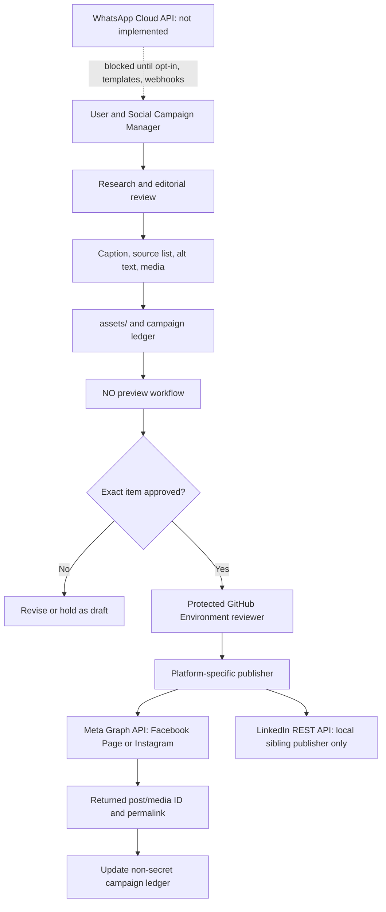

# Technical Architecture and Operations Runbook

## Scope and Current Implementation

This repository contains a VS Code agent/prompt package and protected GitHub Actions publishers. It is not a continuously running social scheduler or a backend web service. Campaign creation is agent-assisted; platform delivery is a manually dispatched workflow after a human approves the exact item.

Implemented in this repository:

- Facebook Page photos and Reels via official Meta Graph API in `scripts/publish_facebook_page.py` and `.github/workflows/publish-facebook-page.yml`.
- Instagram JPEG poster publishing via `scripts/publish_instagram.py` and `.github/workflows/publish-instagram.yml`.
- Instagram Reels publishing via `scripts/publish_instagram_reel.py` and `.github/workflows/publish-instagram-reel.yml`.
- Source-checked daily content planning in `.github/prompts/daily-science-technology-medicine.prompt.md`.
- Platform-specific gates in `.github/prompts/publish-facebook-page.prompt.md` and `.github/prompts/publish-instagram-poster.prompt.md`.
- Offline mock tests in `tests/test_publish_facebook_page.py`, `tests/test_publish_instagram.py`, and `tests/test_publish_instagram_reel.py`.

Adjacent but not included in this repository:

- LinkedIn's local publisher exists in `/Users/poulomigangopadhyay/social-media/publish_linkedin.py` and `linkedin_publisher.py`. It is a sibling local workspace and is not deployed by this repository's GitHub Actions.
- WhatsApp Cloud API is not implemented. This repository must not send to WhatsApp recipients until an authorized integration, business account, opt-in, template/service-window handling, secrets, and webhook processing are built and reviewed.

## System Shape



## Data and Trust Boundaries

1. Agent-authored content is untrusted draft text until a person checks claims, sources, destination, audience, asset, and timing.
2. `assets/` holds campaign media and caption files. Only campaign files within this repository's `assets/` are accepted by the Facebook publisher.
3. Preview jobs run with `approval=NO`; they do not read production tokens and do not make network calls to Meta.
4. Live GitHub jobs read secrets only inside the corresponding protected environment. Secrets are passed through environment variables, never workflow dispatch inputs or source files.
5. Publisher code checks Page identity before any upload and suppresses sensitive transport/response details. Do not enable debug logging that reveals access tokens.
6. Returned post/photo/video/media IDs are publication evidence. A queued workflow or accepted upload is not equivalent to a published post.

## Facebook Page Publisher

### Photo Path

`publish_page_post()` performs the following:

1. Validates `approval` is exactly `NO` or `PUBLISH`, media suffix and file existence, caption path/content, numeric Page ID, exact Page name, and Graph API version.
2. On `NO`, prints destination, Public audience, timing, file path/size, caption, and exits before any network request.
3. On `PUBLISH`, reads `FB_PAGE_ACCESS_TOKEN` from environment and requests `/me?fields=id,name`.
4. Requires the token's returned Page ID and name to match the approved inputs.
5. Uploads the local photo as multipart form-data to `/{page-id}/photos` with the caption and `published=true`.
6. Requires a numeric photo ID; returns `post_id` when Meta supplies one. Ambiguous publish responses are not automatically retried.

### Facebook Reel Path

The Reel publisher implements Meta's documented Page Reels upload sequence:

1. `POST /{page-id}/video_reels` with `upload_phase=start`.
2. Validate Meta's returned upload URL uses HTTPS, the exact `rupload.facebook.com` host, the returned video ID, and no query/fragment.
3. Upload exact local MP4 bytes with OAuth authorization, `offset: 0`, and `file_size` headers.
4. Poll `GET /{video-id}?fields=status` at a bounded interval. Stop on upload/processing error or timeout. Do not finish until `video_status=ready`, or both upload and processing phases report complete.
5. `POST /{page-id}/video_reels` with `upload_phase=finish`, `video_id`, `video_state=PUBLISHED`, title, and description.
6. Require Meta's `success=true`; record video ID and reconcile the Page before retrying any uncertain outcome.

Facebook Page Reels are Public under the API and have a Meta limit of 30 API-published Reels per rolling 24-hour period. The workflow also accepts `FB_REEL_PUBLISH_COUNT_24H` as an operator-supplied guard; it does not query Meta for account-wide usage, so maintain that value/ledger carefully.

### GitHub Actions Setup

On the repository's default branch:

1. Create environment `facebook-production`.
2. Add one or more trusted required reviewers to the environment. The reviewer should inspect the exact preview and media before approving the live job.
3. Add environment variable `FB_PRODUCTION_REVIEW_GATE=enabled` only after confirming the required reviewer rule is active. The publish job fails closed if this attestation is absent.
4. Add environment secret `FB_PAGE_ACCESS_TOKEN`. Do not enter this value in chat, a workflow input, asset, or commit.
5. Add repository variable `FB_GRAPH_API_VERSION` with a Meta-supported `vNN.N` version. Workflow default is `v26.0`; revalidate and update it as Meta deprecates versions.
6. Ensure the token comes from an app that has `pages_show_list`, `pages_read_engagement`, and `pages_manage_posts`, and the authorizing person has the Page `CREATE_CONTENT` task.
7. Run Actions → **Publish Facebook Page Post**. Select the asset/caption and exact Page identity; run once with `NO`, inspect the completed summary, then obtain exact-post approval and dispatch a separate `PUBLISH` run.

Inputs for the optogenetics assets:

```text
media_kind: photo
page_id: 61595341701921
page_name: CHILD & HOPE
asset_path: assets/optogenetics-facebook-page-poster.jpg
caption_file_path: assets/optogenetics-facebook-page-caption.txt
approval: NO
```

For its Reel, use `media_kind: reel`, `assets/optogenetics-facebook-page-reel.mp4`, and title `Optogenetics: light and selected neural circuits`. Use `PUBLISH` only after the separate post preview is approved and the environment is configured.

### Facebook Failures and Recovery

- Token/Page mismatch: stop; confirm the Page ID and Page name and the authorized token. Never change target to make a token pass.
- Permission failure: check app review/access and `CREATE_CONTENT` task. Do not retry until fixed.
- Reel processing error or timeout: the workflow stops before `finish`; inspect status and create a fresh approved run only after reconciling whether a prior video ID exists.
- Timeout/transport failure during photo publish or Reel finish: outcome may be ambiguous. Search the Page or query by returned media ID before any retry. This publisher intentionally avoids automatic retry to prevent duplicates.
- `facebook-production` missing, no reviewer configured, or `FB_PRODUCTION_REVIEW_GATE` absent: expected fail-closed state; configure through repository settings, not code or tokens in chat.

## Instagram Publisher

### Poster

`publish_instagram.py` accepts JPEG/JPEG poster and a caption file with `Caption` and `Alt text` sections. It validates a public HTTPS JPEG URL, rejects credentials/query/fragment/private host values, resolves `/me?fields=user_id,username`, verifies the exact approved alias, creates a media container, polls bounded status, and calls `media_publish` only after `FINISHED`. GitHub Actions protects the publish job using `instagram-production`.

### Reel

`publish_instagram_reel.py` validates a public HTTPS MP4 URL and caption under `assets/`; verifies the username; submits `media_type=REELS`; polls a bounded number of times; and publishes only when Meta returns `FINISHED`. The workflow downloads the exact approved public MP4 and checks its SHA-256 before the protected publishing job. An MP4 must be hosted publicly with a video MIME type; GitHub raw downloads may return an unsupported generic content type.

Instagram deployment requires an eligible Business/Creator account, correct Instagram publishing permissions/token, public media hosting accessible to Meta, and a required reviewer on `instagram-production`. The current workflows publish immediately and do not implement recurring schedules.

## LinkedIn Publisher Boundary

`publish_linkedin.py` and `linkedin_publisher.py` currently live in the separate local `social-media` project, not this repository. That publisher uses LinkedIn's official REST API, resolves a member identity through OIDC userinfo, uploads optional image media, previews exact public post details, then requires a local typed `PUBLISH` confirmation. Required developer-app access includes `w_member_social`; automatic author lookup needs `openid profile`; tokens stay in the sibling project's ignored `.env` (`LINKEDIN_ACCESS_TOKEN`, optional `LINKEDIN_AUTHOR_URN`, `LINKEDIN_VERSION`, currently `202609`).

From `/Users/poulomigangopadhyay/social-media`, publish an already approved member post with:

```sh
python publish_linkedin.py --text-file path/to/caption.txt --image path/to/image.jpg --alt-text "Accessible image description"
```

Omit `--image` and `--alt-text` for text-only content. The script displays its exact preview and requires typing `PUBLISH` locally. It is not a GitHub Actions workflow in this repo; do not describe it as deployed here.

## WhatsApp Cloud API Boundary

There is no WhatsApp sender, webhook endpoint, queue, opt-in database, or template manager in this repository. If implemented later, use Meta's official WhatsApp Business Platform Cloud API, not UI automation:

1. Create/verify a Business Portfolio, WABA, app, and registered business phone number.
2. Request only required Cloud API permissions and store access tokens in a dedicated protected environment secret.
3. Store auditable user opt-in and opt-out states. Do not source contacts from Facebook followers or infer consent from a social post.
4. Outside the 24-hour customer-service window opened by a user's message/call, send only Meta-approved templates. Free-form service replies require an open window. Enforce messaging quality, rate limits, and opt-outs.
5. Add HTTPS webhook verification and signature validation; process incoming messages and delivery/read/failure status webhooks idempotently.
6. Require exact per-campaign approval and recipient cohort review before any campaign send. A public Facebook/Instagram post is not consent for WhatsApp messaging.
7. Do not mark delivery based solely on a successful send API response; reconcile webhook status.

The message endpoint is `POST /{phone-number-id}/messages` on the versioned `graph.facebook.com` host with `Authorization: Bearer …` and JSON `messaging_product`, `to`, `type`, and message body/template fields. Keep the bearer token in a protected environment secret. Webhook verification must use the configured app secret/signature validation; never accept unsigned status payloads as delivery evidence. These are design requirements only; there is no WhatsApp code in the repository yet.

Official docs: [WhatsApp Cloud API](https://developers.facebook.com/docs/whatsapp/cloud-api/), [Send messages](https://developers.facebook.com/docs/whatsapp/cloud-api/guides/send-messages/), [Templates](https://developers.facebook.com/documentation/business-messaging/whatsapp/templates/overview), [Opt-in](https://developers.facebook.com/documentation/business-messaging/whatsapp/getting-opt-in), [Webhooks](https://developers.facebook.com/documentation/business-messaging/whatsapp/webhooks/overview).

## Local Validation

Run the full offline mock suite from the repository root:

```sh
python -m unittest discover -s tests -v
```

The suite covers no-network preview, Page identity mismatch, exact media upload payload, Reel upload host validation, processing failures, bounded waits, token redaction, plus the existing Instagram poster/Reel flows. It does not prove live Meta credentials, permission access, Page state, or delivery; only a protected live workflow run with a returned ID can do that.

## Product/Technical Change Process

1. Draft source-backed content and create the exact assets/caption under `assets/`.
2. Run relevant mock tests and the exact `NO` preview.
3. Have a human check factual claims, visual rendering, Page identity, audience, and caption.
4. Obtain approval for this exact item and timing.
5. Pass the protected GitHub Environment reviewer gate.
6. Reconcile the returned ID/permalink and update the non-secret publication ledger. On an unclear API result, stop and reconcile; never blindly rerun.